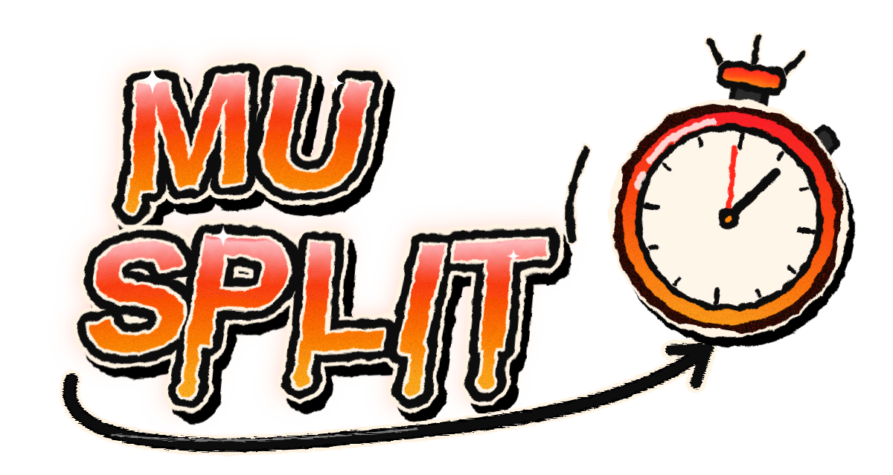

  

  <b>MuSplit is a speedrun timer with LiveSplit's timing and autosplitters, and a smooth, animated, fully customisable look.</b>

  
  
  
  

<!-- Screenshot / GIF: save it as assets/screenshot.gif (or .png) and uncomment the line below -->
<!-- 

 -->

---

## Download

1. Grab the latest `MuSplit.zip` from [Releases](https://github.com/mushymeow/Mu-Split/releases/latest).
2. Unzip it anywhere and run `MuSplit.exe`.
3. Right-click the timer for everything: open your splits, customise, race.

Your LiveSplit splits (`.lss`) work as they are.

## MuSplit vs LiveSplit

| | MuSplit | LiveSplit |
|---|---|---|
| **Timing, `.lss` files, autosplitters** | The same: MuSplit's engine is built on LiveSplit's own code | The original |
| **Drawing** | On your graphics card, every frame: rolling digits, gliding highlight, split pops, sparks and confetti | Windows Forms, drawn by the CPU at a fixed refresh rate |
| **Changing the look** | One Customise window (`F1`) with a live preview | Layout editor plus a settings window per component |
| **Looks and effects** | 12 built-in looks, shaders (bloom, CRT, grain…) and a Workshop to share looks | Layouts and components you find and install yourself |
| **Races** | Built in: send a code, everyone starts on the same countdown | Through racetime.gg, a separate site |
| **Discord status** | Built in | Needs a separate component |
| **Linux** | Native timer, autosplitters through Proton (beta) | Runs under Wine |

## Why MuSplit

- **Same timing as LiveSplit.** Times, splits files and autosplitters behave exactly the same, because MuSplit's engine is built on LiveSplit's open-source code.
- **Smooth.** Everything animates, from the digits to the highlight to the golds and PBs.
- **Simple.** Everything about the look is in one window, and you see each change as you make it.

## Features

### Looks

- 12 built-in looks, a *Surprise me* button, and every colour, font, size and effect as a setting
- Background pictures (drag one onto the timer), gradients, aurora and particles
- Shader effects: bloom, light rays, grain, CRT, scanlines and more
- A **Workshop** to share looks and download other people's
- Per-game looks, `F2` to flip between looks, and sounds for splits, golds and PBs

### Splits

- **Auto Splits**: builds your splits from the autosplitter's settings
- **Subsplits**: sections that fold away when you're not in them (LiveSplit's naming, so your `.lss` files stay compatible)
- Sum of best, best possible time, possible time save and autosplitter status

### Online

- **Races**: make a race, send the code, and everyone's timer starts on the same countdown, with live standings at every split and chat
- **Discord status**: your game, current split and time on your profile

### Window & Platform

- Hide the title bar, always on top, and an in-game overlay mode
- **Linux (beta)**: the timer runs natively and autosplitters work through Proton (see [README-linux.md](README-linux.md))

## Building it yourself

You need Windows and the [.NET SDK](https://dotnet.microsoft.com/download). Run `build.bat`: it downloads LiveSplit's libraries and LÖVE into `vendor\`, puts the app in `dist\` and makes `MuSplit.zip`. Details are in [docs/DEVELOPING.md](docs/DEVELOPING.md).

The race server is a free Cloudflare Worker: see [server/README.md](server/README.md).

## Credits

- [LiveSplit](https://github.com/LiveSplit/LiveSplit) (MIT): the timing engine and autosplitter support MuSplit is built on. Thank you to everyone who works on it.
- [LÖVE](https://love2d.org) (zlib): the app is made with it.
- [moonshine](https://github.com/vrld/moonshine) (MIT): shader effects.

MuSplit isn't made by or affiliated with the LiveSplit team.

## License

[MIT](LICENSE)
